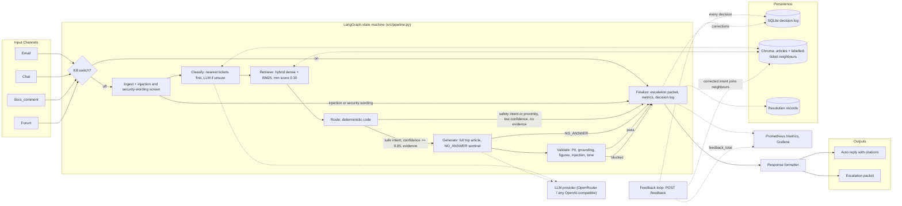

# System Architecture: CloudServe Intelligent Support System

Editable diagram: `docs/architecture.drawio` (open at app.diagrams.net or in the draw.io desktop app). It has three pages that mirror the brief's figures: (1) high-level architecture, (2) low-level layers, (3) the routing decision tree. It is generated by `docs/make_drawio.py`, which also checks the layout for overlaps; edit that script and re-run it rather than editing the XML by hand.

## High-Level Architecture



## Orchestration

As in the brief's low-level design, the orchestrator is a **LangGraph state machine** (`src/pipeline.py`). Nodes: kill_switch, ingest, screen, classify, retrieve, route, generate, validate, finalize. After each node a conditional edge sends the ticket straight to `finalize` once it has been escalated, so the escalation packet, telemetry and decision log are written exactly once, for every path. Each node is wrapped so an exception becomes a logged escalation, never a crash. `process_ticket()` keeps its earlier signature and simply invokes the compiled graph.

## Component Responsibilities

| Component | File | Key function(s) |
|---|---|---|
| Ingest | `src/ingest.py` | `normalize_ticket()`; accepts `api_comments` as alias of `docs_comment` |
| Classify | `src/classify.py` | kNN over dev tickets (`dev_tickets_v3`), LLM fallback, agreement-based confidence |
| Retrieve | `src/retrieve.py` | `embed_corpus()`, `retrieve_passages()`, `select_for_generation()` |
| Route | `src/route.py` | `route_ticket()`, escalation context packet |
| Generate | `src/generate.py` | `generate_response()` using `generate_v3.txt` |
| Guardrails | `src/guardrails.py` | `run_guardrails()` |
| Log | `src/logging_store.py` | decision log and resolution records |
| LLM client | `src/llm.py` | `chat()`, retries, circuit breaker, fail-fast on 401/402 |
| Pipeline | `src/pipeline.py` | `process_ticket()`, `warm_up()`, `kill_switch_on()` |
| Telemetry | `src/telemetry.py` | Prometheus counters and histograms |
| Response formatter | `src/formatter.py` | Turns a pipeline result into the API payload (reply + citations, or escalation packet) |
| Feedback loop | `src/feedback_loop.py` | `POST /feedback`: human corrections stored in the audit DB and added to the neighbour index |
| API | `src/api.py` | `/tickets` (alias `/process`), `/feedback`, `/decisions/{id}`, `/health`, `/metrics`, `/admin/kill-switch` |

## Routing Decision Logic

Routing is code, not a model call. It follows the brief's decision tree (confidence, then evidence, then guardrails), with two safety additions in front. First match wins:

```
if kill_switch:                                   escalate  (kill_switch)
if injection or security wording in the ticket:   escalate  (injection_screen / safety_keyword)   # before any model call
if predicted_intent in SAFETY_INTENTS:            escalate  (safety_intent)
if restricted-topic vote weight >= 0.10:          escalate  (safety_proximity)
if confidence < CONFIDENCE_THRESHOLD (0.85):      escalate  (low_confidence)
if no passage above the relevance floor:          escalate  (no_passages)
generate -> NO_ANSWER                             escalate  (model_declined)
guardrails block                                  escalate  (guardrail_block)
else:                                             auto_respond
```

The threshold 0.85 is not a guess: `evaluation/calibrate.py` classifies every development ticket as if its wording were new, fits the confidence on those samples, and picks the lowest threshold at which auto-answered tickets are classified correctly at least 99% of the time (`evaluation/results/threshold_selection.json`).

An escalation always carries a summary, the retrieved sources and a reason code.

## Guardrails

| Name | Trigger | Action |
|---|---|---|
| PII | Personal data or secrets in the outbound reply | Block and escalate |
| Grounding | Claim not traceable to the shown documents | Block and escalate |
| Figures | Number, version or duration not in sources or the customer's own text (checked in every sentence) | Block and escalate |
| Injection | Ticket tries to alter instructions (screened before any LLM call) | Block and escalate |
| Tone/Scope | Refund promises or timeline commitments | Block |
| Confidence floor | Routing threshold not actually applied | Escalate |

## Decision Log (SQLite)

Each decision stores: decision id, timestamp, ticket id, stage, model and prompt version (e.g. `PR-GN-01 v3.0`), prediction and confidence, sources used with scores, threshold applied, action taken, reason code, guardrail results, requirement IDs, and run id. `GET /decisions/{ticket_id}` returns them.

## Technology Stack

| Layer | Technology |
|---|---|
| Language | Python 3.9 to 3.11 |
| Vector store | Chroma (local) |
| Embeddings | `all-MiniLM-L6-v2` (local, no API cost) |
| LLM access | OpenRouter by default; any OpenAI-compatible endpoint via `LLM_BASE_URL` |
| Default model | `meta-llama/llama-3.1-8b-instruct` |
| Judge model | `openai/gpt-4o-mini` (independent of the generator) |
| HTTP | FastAPI |
| Decision log | SQLite |
| Monitoring | Prometheus metrics at `/metrics`; Grafana dashboard is Stage 6 |
| CI | GitHub Actions |

## Monitoring Dashboard (Stage 6)

1. Tickets per hour by channel and outcome
2. Auto-reply vs escalation share
3. Latency median and p95 (target p95 under 3 s)
4. Guardrail activations by type
5. Confidence distribution, to spot threshold drift

## Conformance with the brief's design

High-level design (six components over three cross-cutting concerns) and low-level design (three layers).

| Brief | This system | Status |
|---|---|---|
| Ingest, Classify, Retrieve, Route, Generate, Validate in sequence | Same six steps as LangGraph nodes | Matches |
| Cross-cutting: Audit log | SQLite decision log, one record per ticket, alternatives and sources included | Matches |
| Cross-cutting: Monitoring (latency, volume, drift) | Prometheus metrics, five alert rules, Grafana dashboard; run and verified | Matches |
| Cross-cutting: Feedback loop (human corrections return) | `POST /feedback`; corrections change the neighbour index; counted in `feedback_total` | Matches (added after the audit) |
| Application layer: FastAPI `/tickets` | `/tickets` (and `/process`) | Matches |
| Application layer: Orchestrator, LangGraph state machine | LangGraph `StateGraph` | Matches |
| Application layer: Guardrail middleware | `validate` node between generation and release; can block | Matches (a graph node, not HTTP middleware) |
| Application layer: Response formatter | `src/formatter.py` | Matches |
| Model layer: Classifier chain (few-shot) | Few-shot prompt PR-CL-01 v2.0 plus nearest-ticket vote | Matches (nearest-ticket first, the model when unsure) |
| Model layer: Embedding model MiniLM-L6-v2 | all-MiniLM-L6-v2, local | Matches |
| Model layer: Chroma vector store (hybrid search) | Chroma dense search fused with BM25 by reciprocal rank | Matches; no measurable gain on this 29-article corpus (see report) |
| Model layer: Generator chain with citations | Generator prompt PR-GN-01 v3.0, inline citations checked against retrieved articles | Matches |
| Persistence: PostgreSQL decision log | SQLite | Deliberate: the brief allows SQLite; `DATABASE_URL` would need a Postgres driver to change |
| Persistence: Prometheus, Grafana, GitHub Actions | All three configured; Grafana verified locally; Actions workflow written but never run on a remote | Matches, CI unverified |
| Routing tree: confidence 0.80, then retrieval, then guardrails | confidence threshold from data (0.85), then evidence, then guardrails; plus safety rules in front | Extended, not contradicted |

