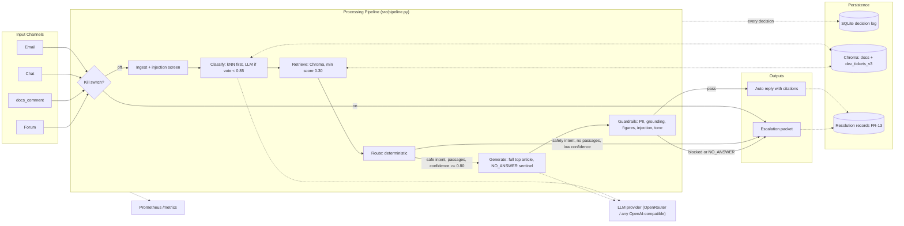

# System Architecture: CloudServe Intelligent Support System

Editable diagram: `docs/architecture.drawio` (open at app.diagrams.net or in the draw.io desktop app).

## High-Level Architecture



## Orchestration

The brief suggests LangChain with LangGraph. This system does not use them. `process_ticket()` in `src/pipeline.py` is an ordinary function that runs the steps in a fixed order with early exits (kill switch, injection screen, routing, guardrails). The flow has no loops or branches that need a graph engine, the routing must be deterministic code, and a plain function is simple to test offline (93 tests, no network). The packages stay in `requirements.txt` only because the brief lists them; they can be removed.

## Component Responsibilities

| Component | File | Key function(s) |
|---|---|---|
| Ingest | `src/ingest.py` | `normalize_ticket()`; accepts `api_comments` as alias of `docs_comment` |
| Classify | `src/classify.py` | kNN over dev tickets (`dev_tickets_v3`), LLM fallback, agreement-based confidence |
| Retrieve | `src/retrieve.py` | `embed_corpus()`, `retrieve_passages()`, `select_for_generation()` |
| Route | `src/route.py` | `route_ticket()`, escalation context packet |
| Generate | `src/generate.py` | `generate_response()` using `generate_v3.txt` |
| Guardrails | `src/guardrails.py` | `run_guardrails()` |
| Log | `src/logging_store.py` | decision log and resolution records |
| LLM client | `src/llm.py` | `chat()`, retries, circuit breaker, fail-fast on 401/402 |
| Pipeline | `src/pipeline.py` | `process_ticket()`, `warm_up()`, `kill_switch_on()` |
| Telemetry | `src/telemetry.py` | Prometheus counters and histograms |
| API | `src/api.py` | `/health`, `/process`, `/decisions/{id}`, `/metrics`, `/admin/kill-switch` |

## Routing Decision Logic

Routing is code, not a model call. First match wins:

```
if kill_switch:                         escalate  (kill_switch)
if predicted_intent in SAFETY_INTENTS:  escalate  (safety)
if no passages above MIN_SCORE:         escalate  (no_evidence)
if confidence < CONFIDENCE_THRESHOLD:   escalate  (low_confidence)   # 0.80
else:                                   generate
generate -> NO_ANSWER                   escalate
guardrail blocks                        escalate
else:                                   auto_respond
```

SAFETY_INTENTS = security_incident, compliance_request, feature_request, unclear_request. The rule uses the predicted intent only; ground-truth labels are never read at inference.

An escalation always carries a summary, the retrieved sources, and the reason code.

## Guardrails

| Name | Trigger | Action |
|---|---|---|
| PII | Personal data or secrets in the outbound reply | Block and escalate |
| Grounding | Claim not traceable to the shown documents | Block and escalate |
| Figures | Number, version or duration not in sources or the customer's own text (checked in every sentence) | Block and escalate |
| Injection | Ticket tries to alter instructions (screened before any LLM call) | Block and escalate |
| Tone/Scope | Refund promises or timeline commitments | Block |
| Confidence floor | Routing threshold not actually applied | Escalate |

## Decision Log (SQLite)

Each decision stores: decision id, timestamp, ticket id, stage, model and prompt version (e.g. `PR-GN-01 v3.0`), prediction and confidence, sources used with scores, threshold applied, action taken, reason code, guardrail results, requirement IDs, and run id. `GET /decisions/{ticket_id}` returns them.

## Technology Stack

| Layer | Technology |
|---|---|
| Language | Python 3.9 to 3.11 |
| Vector store | Chroma (local) |
| Embeddings | `all-MiniLM-L6-v2` (local, no API cost) |
| LLM access | OpenRouter by default; any OpenAI-compatible endpoint via `LLM_BASE_URL` |
| Default model | `meta-llama/llama-3.1-8b-instruct` |
| Judge model | `openai/gpt-4o-mini` (independent of the generator) |
| HTTP | FastAPI |
| Decision log | SQLite |
| Monitoring | Prometheus metrics at `/metrics`; Grafana dashboard is Stage 6 |
| CI | GitHub Actions |

## Monitoring Dashboard (Stage 6)

1. Tickets per hour by channel and outcome
2. Auto-reply vs escalation share
3. Latency median and p95 (target p95 under 3 s)
4. Guardrail activations by type
5. Confidence distribution, to spot threshold drift
