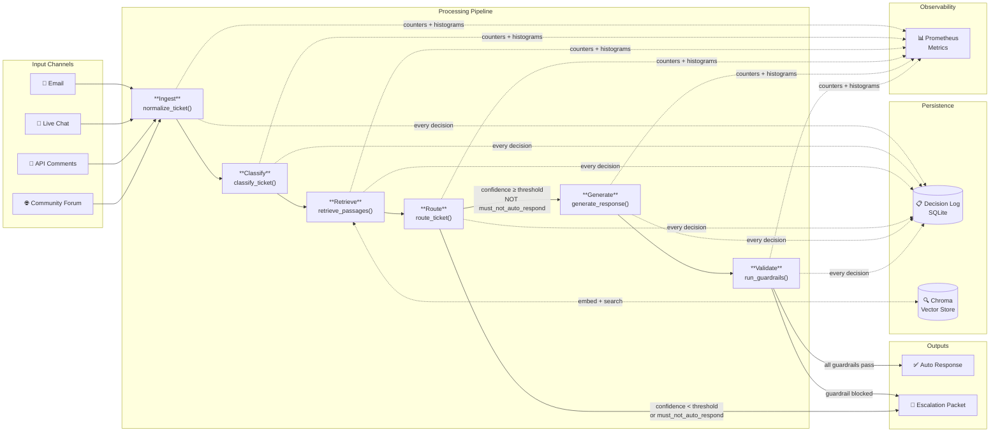

# System Architecture — CloudServe Intelligent Support System

## High-Level Architecture



---

## Component Responsibilities

| Component | File | Key Function(s) | Acceptance Criteria |
|-----------|------|----------------|---------------------|
| **Ingest** | `src/ingest.py` | `normalize_ticket()` | A2 — all 4 channels normalised |
| **Classify** | `src/classify.py` | `classify_ticket()` | A3 — intent + urgency + confidence 0–1 |
| **Retrieve** | `src/retrieve.py` | `embed_corpus()`, `retrieve_passages()` | A4 — sources resolve to real passages |
| **Route** | `src/route.py` | `route_ticket()` | A5 — deterministic, threshold applied |
| **Generate** | `src/generate.py` | `generate_response()` | A6 — citations resolve to retrieved passages |
| **Validate** | `src/guardrails.py` | `run_guardrails()` | A7 — at least one guardrail blocks when triggered |
| **Log** | `src/logging_store.py` | `log_decision()`, `count_decisions()` | A8 — every decision logged |
| **API** | `src/api.py` | `POST /process` | A1, A9 — runnable, full pipeline |

---

## Routing Decision Logic

```
threshold  = CONFIDENCE_THRESHOLD  (from .env, default 0.80 — justify in evaluation report)
confidence = classify_ticket(ticket).confidence
passages   = retrieve_passages(ticket.body)
must_block = ticket.labels.must_not_auto_respond  (safety flag — always escalate if True)

if confidence >= threshold
   AND len(passages) > 0
   AND NOT must_block:
    ──► generate_response(ticket, passages) ──► run_guardrails() ──► auto_respond
else:
    ──► escalation_packet(summary, passages, uncertainty_reason) ──► escalate
```

An escalation always carries:
- `summary`: 2-sentence summary of the ticket
- `retrieved_sources`: passages found (even if confidence was low)
- `uncertainty_reason`: why the system did not auto-respond

---

## Five Guardrails

| # | Name | Trigger | Action |
|---|------|---------|--------|
| G1 | PII | Names, addresses, keys, account numbers in outbound response | Block + escalate |
| G2 | Grounding | Factual claim not traceable to a retrieved passage | Block + escalate |
| G3 | Injection | Ticket text attempts to alter system instructions | Block + escalate + record |
| G4 | Tone/Scope | Response makes refund promises or timeline commitments | Block |
| G5 | Confidence Floor | Routing threshold was not actually applied | Escalate |

---

## Decision Log Schema

Every automated decision writes to SQLite with this structure:

```json
{
  "decision_id":        "uuid",
  "timestamp":          "2024-01-15T09:00:00Z",
  "ticket_id":          "DEV-0001",
  "stage":              "classify | route | generate | guardrail",
  "input_summary":      "Brief description of what was processed",
  "model":              {"name": "meta-llama/llama-3.1-8b-instruct", "version": "..."},
  "prediction":         {"value": "billing_inquiry", "confidence": 0.87},
  "alternatives":       [{"value": "refund_request", "confidence": 0.08}],
  "sources_used":       [{"doc_id": "DOC-BILL-001", "score": 0.92}],
  "threshold_applied":  0.80,
  "action_taken":       "auto_respond",
  "reason":             "Confidence 0.87 exceeds threshold 0.80; 2 relevant passages found",
  "guardrail_results":  {"pii": "pass", "grounding": "pass", "tone": "pass"},
  "prompt_version":     "PR-CL-01 v1.0",
  "requirement_ids":    ["FR-03", "FR-04"]
}
```

---

## Technology Stack

| Layer | Technology | Notes |
|-------|-----------|-------|
| Language | Python 3.10+ | |
| Orchestration | LangChain + LangGraph | Pipeline + agent logic |
| Vector Store | Chroma | Runs locally — no service to provision |
| Embeddings | `all-MiniLM-L6-v2` | Local, no API cost |
| LLM Access | OpenRouter (free tier) | |
| Default Model | `meta-llama/llama-3.1-8b-instruct` | Change via `.env` |
| HTTP Interface | FastAPI | |
| Decision Log | SQLite | Via `DATABASE_URL` in `.env` |
| Monitoring | Prometheus + Grafana | |
| CI/CD | GitHub Actions | `.github/workflows/ci.yml` |

---

## Monitoring Dashboard (Prometheus + Grafana)

The dashboard must show:
1. Tickets processed per hour, split by channel and outcome
2. Auto-answered vs escalated proportion (track against 30% target)
3. Response latency at median and P95 (target: P95 < 3s)
4. Guardrail activations by type over time
5. Confidence score distribution (where threshold drift shows up first)
